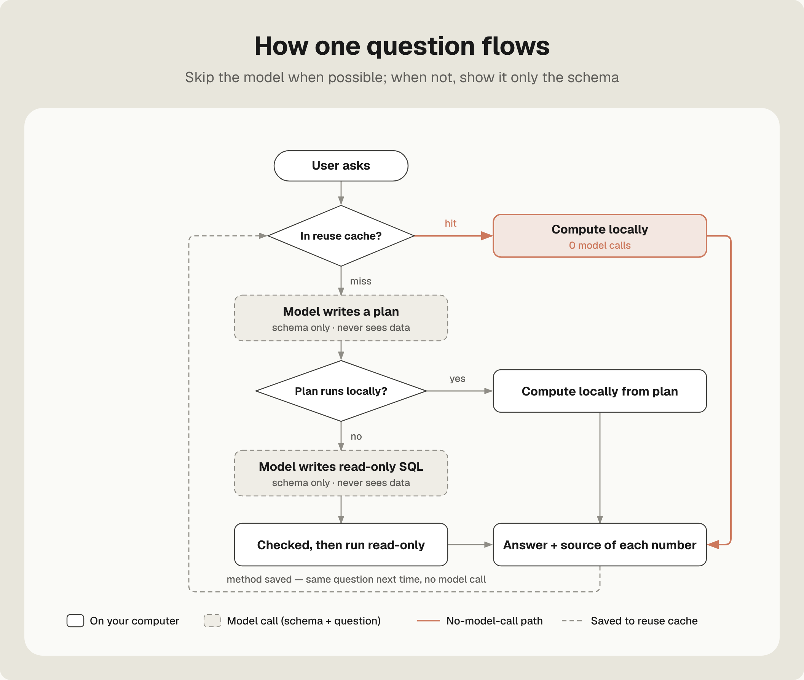
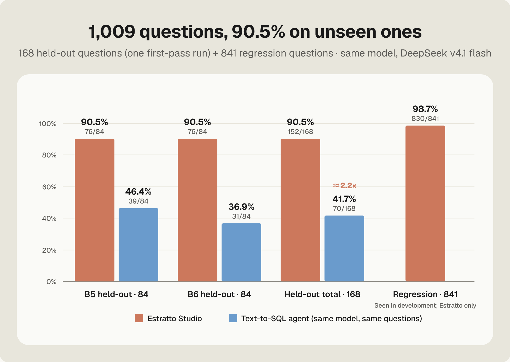
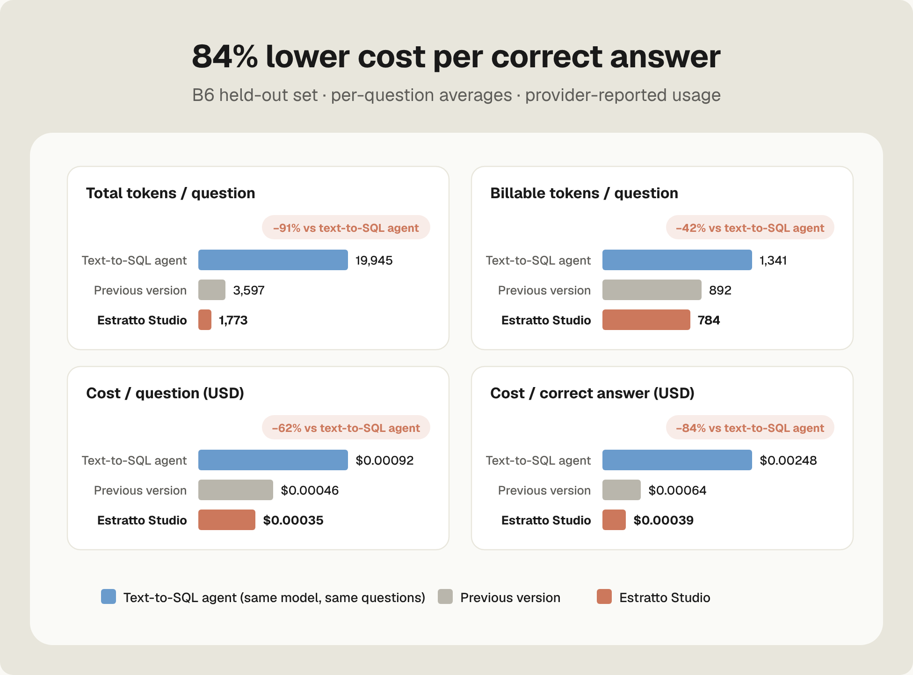

<p align="center"></p>

<p align="center"><b>English</b> · <a href="README.zh-CN.md">简体中文</a></p>

<h1 align="center">Estratto Studio</h1>

<p align="center"><b>A local-first data management and analytics app. Ask in plain language; every number is computed on your own machine.</b></p>

<p align="center">  
<a href="#why-estratto-studio">About</a> ·  
<a href="#how-it-works">How it works</a> ·  
<a href="#how-it-compares">How it compares</a> ·  
<a href="#results">Results</a> ·  
<a href="report/mechanism-report.md">Full report</a> ·  
<a href="#roadmap">Roadmap</a>  
</p>

---

Estratto Studio is a data management and analytics app that runs on your own computer. Its first version was built for business analytics. Import your data, and every number you get back is computed locally and traceable to its source. The language model reads only your question and your table schema. It never sees your row-level data. And you can reshape Studio itself: in the Studio Lab, describe the change you want and the assistant adds or reworks dashboard cards as a draft you can undo, then applies them only when you say so. Every card is built from Studio’s own components, so it always matches the Studio design system.

> **Status:** technical preview. This repository currently holds the mechanism report and benchmark results for round 6 (October 2026). The application source will be published here; see the [Roadmap](#roadmap).

## Why Estratto Studio

Serious analysis of your own data has been gated behind three things:

- **Enterprise semantic-layer and BI platforms.** They need a cloud data warehouse, a data team to model metrics, and a licence budget. Keeping data in a cloud warehouse also carries a risk of leaks or unwanted sharing.
- **Text-to-SQL agents.** They need SQL skills to check their work, and they send your data to a model while they explore it.
- **General-purpose agents.** They need detailed, carefully written prompts, and they tend to read large parts of your tables into the conversation, so the bigger the table, the more tokens you pay for.

Individuals and small teams usually have neither of the first two. What they have is a stack of spreadsheets and exported files.

**Estratto Studio brings this enterprise-grade experience down to the personal computer:**

- **the consistent, governed metrics of a semantic layer;**
- **the conversational flexibility of a SQL agent;**
- **the traceable results of a BI tool;**
- **all in one desktop app: no SQL skills needed, no cloud warehouse, no modelling up front, no row-level data leaving your computer, and the LLM of your choice.**

**Our goal: let everyone manage and analyse their own data more easily and effectively, and see more of it at a lower cost.**

## How it works

The model understands; the local engine computes. Every question passes through the same pipeline:

| Step                              | What happens                                                                                                                                                                                                             | Model involved?                      |
| --------------------------------- | ------------------------------------------------------------------------------------------------------------------------------------------------------------------------------------------------------------------------ | ------------------------------------ |
| **① Automatic modelling**         | At import, a semantic layer is generated automatically: a built-in dictionary of 544 metrics, one schema-only model call for unknown columns, and table relationships verified against the data. No manual modelling.    | Once per new column set, schema only |
| **② Model fills a plan**          | Candidates are retrieved locally, and the model picks from at most 8 of them. It fills a structured plan (metric, grouping, time, filters, ranking, comparison) and writes no numbers.                                   | Yes, 1 call (+1 repair)              |
| **②b Restricted SQL fallback**    | Used only when a plan cannot express the question. The model writes one read-only SQL query, which must pass three local gates: parsed and checked, run read-only and offline, then graded against the semantic layer.   | Only when needed, 1 call (+1 repair) |
| **③ Local deterministic compute** | DuckDB computes every number on your machine. Hard rules are fixed in code: ratios are sum ÷ sum, and snapshot metrics use the period-end value.                                                                         | No                                   |
| **④ Outbound Gate**               | The only exit to the model. For Ask, it sends schema and question only. For the assistant, it sends aggregates only, at most 60 numbers per release, with entity names masked as codes (G1, G2 …). Every send is logged. | —                                    |
| **⑤ Fact-ID backfill**            | Every number becomes a fact (F1, F2 …). The model writes text with placeholders, and the numbers are filled in locally, so the model cannot invent a figure.                                                             | No                                   |
| **⑥ Reuse**                       | The verified method is stored, not the result. The same question asked again is recomputed locally with zero model calls. Stored methods are invalidated by changes to permissions, definitions or code.                 | No                                   |

At most 4 model calls per question, all with schema only.

<p align="center"></p>

## How it compares

Most products cover only part of this pipeline. Estratto Studio covers all of it, on a single personal computer.

| Capability                                                          | Estratto Studio | Text-to-SQL agent¹ | Vanna² | WrenAI³ | dbt Semantic Layer⁴ | ThoughtSpot Spotter⁵ | Snowflake Cortex Analyst⁶ | Databricks Genie⁷ |
| ------------------------------------------------------------------- | :-------------: | :----------------: | :----: | :-----: | :-----------------: | :------------------: | :-----------------------: | :---------------: |
| ① Semantic layer built automatically, no manual modelling           |        ✓        |          ✗         |    ◐   |    ◐    |          ✗          |           ?          |             ◐             |         ◐         |
| ② Model outputs a structured plan, not raw SQL                      |        ✓        |          ✗         |    ✗   |    ✗    |          ✓          |           ✓          |             ✗             |         ✗         |
| ②b Automatic restricted-SQL fallback when the plan can't express it |        ✓        |          —         |    —   |    —    |          ◐          |           ?          |             —             |         —         |
| ③ Runs on a personal computer, no cloud warehouse needed            |        ✓        |          ◐         |    ✓   |    ◐    |          ✗          |           ✗          |             ✗             |         ✗         |
| ④ Model never sees data rows or values                              |        ✓        |          ✗         |    ◐   |    ?    |          ?          |           ?          |             ✗             |         ✗         |
| ⑤ Numbers in answers backfilled from local facts                    |        ✓        |          ✗         |    ?   |    ?    |          ?          |           ?          |             ?             |         ?         |
| ⑥ Same question again → zero model calls                            |        ✓        |          ✗         |    ?   |    ?    |          ?          |           ?          |             ◐             |         ◐         |

✓ supported · ◐ partial or needs manual work · ✗ not supported · — not applicable (SQL is already the main path) · ? not stated in public docs

<sub>Based on each product's public documentation as of October 2026; corrections are welcome via issues. Notes:  
¹ The text-to-SQL agent measured in this report: a multi-step agent that writes SQL and reads up to 60 result rows per step. It runs wherever you host it.  
² Retrieval over DDL, docs and question–SQL pairs that you train; can run fully local with Ollama; the LLM writes SQL. Its RAG flow sends schema only.  
³ MDL semantic layer with agent-assisted context building that you review; the LLM writes SQL against the MDL; self-hostable.  
⁴ You define metrics and dimensions; the LLM selects them and MetricFlow generates SQL deterministically. dbt recommends falling back to text-to-SQL when the layer can't answer.  
⁵ The LLM writes AgentQL, which is translated deterministically to SQL; it requires a ThoughtSpot data model and runs on your cloud warehouse.  
⁶ Semantic views can be drafted with Autopilot; the LLM writes SQL; relevant literal values are retrieved and passed to the LLM; human-verified queries are reused as context.  
⁷ Authors curate spaces (instructions, example SQL, knowledge store); the LLM writes SQL; sample column values inform generation; trusted assets reuse verified SQL.</sub>

## Results

We ran **1,009 questions** in total, all on the same model (DeepSeek v4.1 flash):

- **168 held-out questions** the engine had never seen (84 each in B5 and B6; each system ran once): 90.5% correct (152/168), about 2.2× the text-to-SQL agent (70/168).
- **841 regression questions**: 98.7% correct (830/841), with every previously correct question still correct.

<p align="center"></p>

The table below breaks down the 84 held-out questions in B6:

| Metric                             |     Estratto Studio    |          Text-to-SQL agent          | Difference |
| ---------------------------------- | :--------------------: | :---------------------------------: | :--------: |
| Correct answers                    |   **76 / 84 (90.5%)**  |           31 / 84 (36.9%)           |  **2.45×** |
| Tokens per question                |        **1,773**       |                19,945               |  **−91%**  |
| Cost per question                  |      **$0.00035**      |               $0.00092              |  **−62%**  |
| Cost per correct answer            |      **$0.00039**      |               $0.00248              |  **−84%**  |
| Data rows sent to the model        |          **0**         |          up to 60 per step          |      —     |
| Same question again, no model call | **84.5% need no call** | 0% (every question calls the model) |      —     |

- **Accurate on unseen questions.** 76/84 (90.5%) on B6, 2.45× the text-to-SQL agent, and 76/84 on a second held-out set (B5).
- **No regressions.** 830 of 841 regression questions correct. Public set: 198/200 Chinese and 67/67 English. Internal set: 494/500 and 57/60. dbt and Neo4j examples: 14/14. Every previously correct question is still correct.
- **Reuse never turns a right answer wrong.** 260 of 266 reused answers were correct (97.74%). Every reuse error came from a question that was already wrong the first time.
- **Secure by construction.**
  - Five end-to-end permission-bypass attempts were all blocked.
  - 596 model requests were audited independently, and no data values were found in them.
  - The compute process cannot reach the network, and the network process cannot read your data; both are enforced by the OS sandbox.
- **Cost doesn't grow with table size**, because data rows are never sent.

<p align="center"></p>

The text-to-SQL agent had the same schema, metric definitions and 4-call limit as Estratto Studio. Methodology, per-dataset results and every mechanism are covered in the [full report](report/mechanism-report.md).

## What's inside

| Area            | Highlights                                                                                                                                                                                                                   |
| --------------- | ---------------------------------------------------------------------------------------------------------------------------------------------------------------------------------------------------------------------------- |
| Understanding   | Bilingual dictionary of 544 metrics; personal aliases and definitions; local embedding models (bge-small-zh-v1.5 bundled, with multilingual-e5-small for mixed-language data) that switch on only after passing a local exam |
| Computation     | DuckDB with typed current-version tables. Ten calculation types beyond sums and averages (rank positions, top-N share, actual vs plan, days of cover …). Time expressions resolved with a calendar library                   |
| Trust           | Verified / pending / unverified grades; a fact ID on every number; asks when ambiguous; refuses when a field is missing instead of substituting another                                                                      |
| Privacy         | Outbound Gate with a disclosure ledger; permission scope can only be narrowed; values from the value catalog are never sent to the model                                                                                     |
| Retrieval (RAG) | Local retrieval of candidates, relevant tables, memories, document passages and ranked findings; vectors are built from names and text only, never numbers                                                                   |
| Storage         | DuckDB for data and computation; SQLite for memory, facts, reports, the reuse cache and the ledger. Everything stays on your machine                                                                                         |

## Roadmap

Estratto Studio is under active development, and this report will be updated as it evolves.

- [ ] Publish the application source and the first release
- [ ] Keep improving reuse and accuracy on new questions
- [ ] Make better use of provider-side prompt caching to cut expensive tokens further
- [ ] Extend the Studio Lab from cards to whole custom pages, generated within the Studio design system

## Repository layout

```
README.md               this overview (English)
README.zh-CN.md         overview (Chinese)
report/                 full mechanism report (EN / ZH)
docs/images/            figures (en/, zh/) and covers
LICENSE                 CC BY 4.0 (report, figures, docs)
```

## License

Copyright (c) 2026 Jackson Wu (j7ckson).

The report, figures and documentation in this repository are licensed under [CC BY 4.0](LICENSE). You may share and adapt them, including for commercial use, as long as you give appropriate credit and indicate if changes were made.

The Estratto Studio application source is not in this repository yet. When it is released, it will be published under the GNU AGPLv3, with a separate commercial licence available.

## Citation

> Jackson Wu (j7ckson). Estratto Studio — Mechanism Report, round 6, October 2026.
