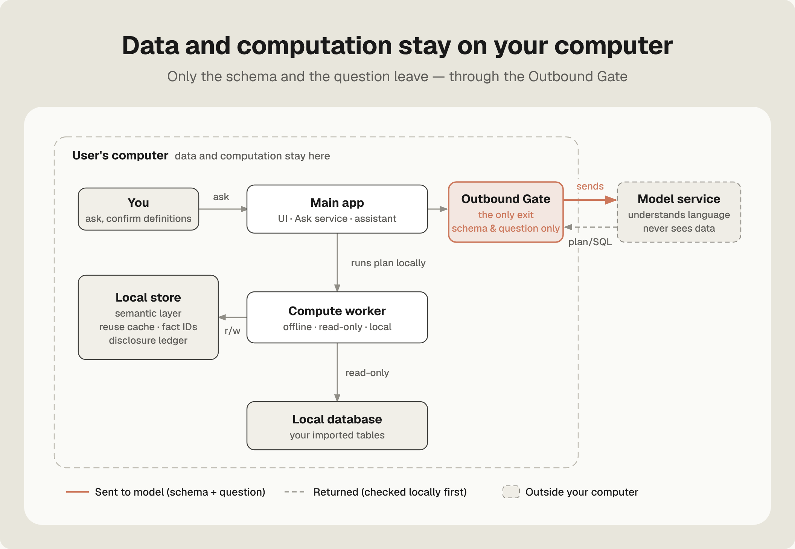
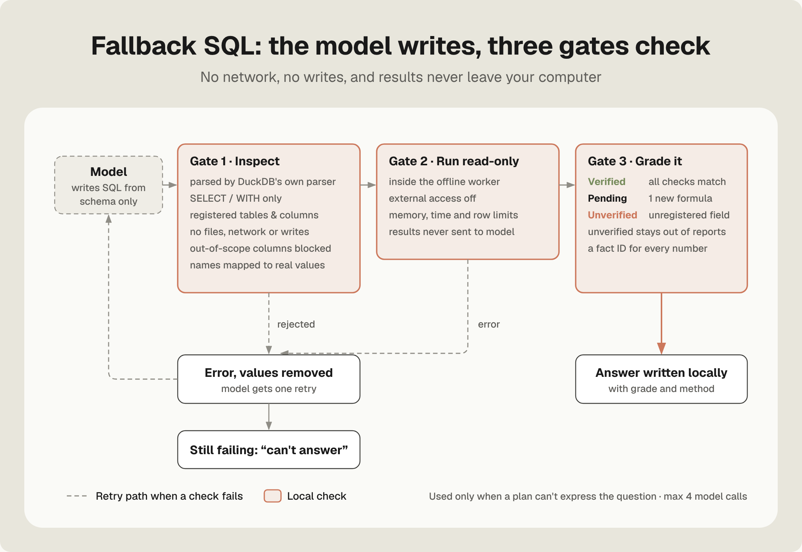
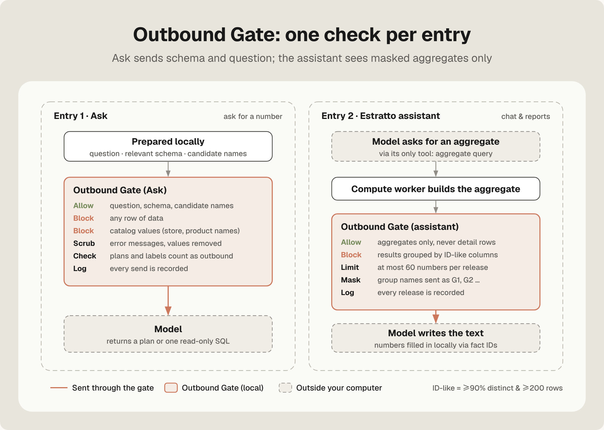
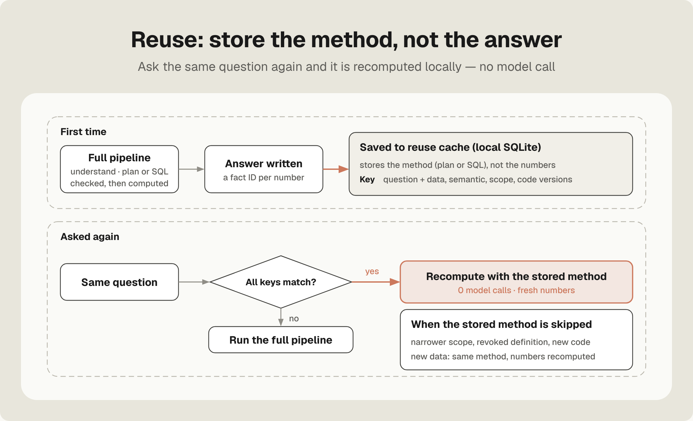
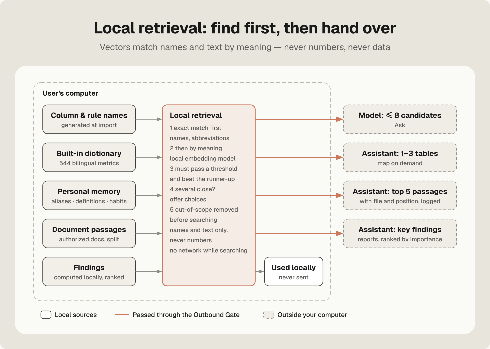

<b>English</b> · <a href="mechanism-report.zh-CN.md">简体中文</a>

# Estratto Studio — Mechanism Report

j7ckson

> **Status: work in progress.** This report describes the current engine. It will be updated as the engine and the benchmark change.

## Summary

Estratto Studio is a **data management and analytics app** that runs on the user's own computer (the first version was built around business analytics). Users ask questions, and it computes the answers from the tables they have imported.

This report covers two things: **how the engine works**, and **how well it performs**.

The core idea: **the model understands, the local engine computes.** The language model reads the question and the table schema and writes a structured plan. A local engine checks the plan and computes every number with DuckDB. The model never sees data rows.

Results on **B6**, a held-out set of 84 questions that the engine had never seen, with each system running once on the same model:

- **90.5% correct** (76/84). A text-to-SQL agent got 36.9% (31/84), so Estratto Studio gets **2.45×** as many correct answers.
- **1,773 tokens per question**, against 19,945 for the text-to-SQL agent (−91%). **Average cost per correct answer is 84% lower.**
- **84.5% of questions need no model call** when asked a second time.
- **No data rows are sent to the model.**

---

## 1. Terms used in this report

| Term | Meaning |
|---|---|
| Estratto Studio | The product: a **data management and analytics app** that runs on the user's own computer (the first version was built around business analytics). |
| Local | The computer with Estratto Studio installed. Data is stored and computed there; no server is needed. |
| Model | The remote large language model service. It reads language and does not compute numbers. In this report: DeepSeek v4.1 flash via OpenCode Go. |
| Text-to-SQL agent | The comparison system: a multi-step agent that writes its own SQL. It uses the same model and gets the same schema, metric definitions and table relationships. It writes read-only SQL, sees up to 60 result rows per query, may call the model up to 4 times, and must answer on the last call. |
| Held-out set (B5, B6) | Two sets of 84 new questions each (60 Chinese, 24 English). They were written by Codex GPT-6.1-Sol (medium), frozen before any run, and never seen during development. |
| Single run | Each system answers each question once. Nothing is re-run to pick a better result. |
| Semantic layer | A local "manual" describing each table and column, how each metric is calculated, and how tables join. |
| Plan | A structured description of what to compute: metric, grouping, time range, filters, ranking, comparison. It contains no numbers. |
| Fallback SQL | A read-only SQL query written by the model, used only when a plan cannot express the question. It is checked locally before it runs. |
| Outbound Gate | The single local exit for anything sent to the model. It decides what may leave and logs every send. |
| Fact ID | An ID (F1, F2 …) attached to every number the engine computes. It records how that number was computed. |
| Definition | How a metric is calculated, for example whether "sales" includes refunds. |
| Token | The unit models charge by. |
| Billable tokens | Uncached input tokens plus output tokens. Cached input is charged at about 1/50 of the price. |
| Zero-call answer | An answer produced without any model call, from the reuse cache. |

## 2. Background: why question answering is hard

A business question-answering engine must deliver **correct numbers, low cost and private data** all at once.

- **Language is ambiguous.** "Sales last month" can include or exclude refunds. Inventory is a point-in-time value, so adding up daily snapshots gives a wrong number. Once a question is misunderstood, the number can be badly wrong.
- **Models compute poorly.** Language models are good at understanding text but unreliable at arithmetic, and their wrong numbers look convincing.
- **Data is sensitive.** Sending orders and customer records to a remote model means handing them to a third party.
- **Models charge per token.** Every extra round trip and every extra row drives up cost.

Common approaches each cover only part of this:

| Approach | How | Strength | Cost |
|---|---|---|---|
| Text-to-SQL agent | The model writes SQL, reads results, iterates | Flexible, no setup | Accuracy depends on the run; about 20k tokens per question here; data rows go to the model |
| Semantic-layer products | People model metrics first; the model picks from them | Accurate within the model | Manual modeling up front; questions outside the layer cannot be answered |
| Frontier general agents | The strongest models explore the data | Usually accurate | Many times more expensive; data goes to the model |

**Estratto Studio's approach:** split understanding from computing. The model reads the question and the schema. All numbers are computed locally. The semantic layer is generated automatically at import, so no manual modeling is needed. Methods that have already been worked out are saved and reused.

## 3. Architecture

Figure 1. Everything inside the dashed box runs on the user's computer. Only the schema and the question pass through the Outbound Gate to the model. Whatever the model returns is checked locally before it runs.

| Component | Where | Does | Does not |
|---|---|---|---|
| Main app | local | UI; data analysis and the Estratto assistant; passes questions to the model and plans to the compute worker | interpret data for the model |
| Compute worker | local | computes with the embedded analytical database (DuckDB) | reach the network; write outside the workspace (enforced by the OS sandbox) |
| Local database | local | stores imported tables | upload anything |
| Local store | local | semantic layer, reuse cache, fact IDs, disclosure ledger | store API keys |
| Outbound Gate | local | checks and logs every outbound payload | let data rows through |
| Model service | online | reads the question; returns a plan, or one read-only SQL query | see data; compute numbers |

**Two entry points, one engine.** Users can ask for a number directly (Ask), or chat with the Estratto assistant and ask it to write an analysis. Both use the same Ask service, the same semantic layer and the same outbound rules, so the same question gives the same number from either entry point.

## 4. Mechanisms

### 4.1 Import and automatic semantic layer

Some companies have no single ERP. Their data may be exported from different sources such as storefronts, ad platforms and marketplaces, with English column names like Ad Spend or Clicks, while users ask in Chinese. The engine has to know what each column means and how tables connect.

At import, without manual modeling:

1. **Built-in dictionary first.** About 544 bilingual terms and common metrics across ads, e-commerce, finance, inventory and logistics. For example, ROAS = ad revenue ÷ ad spend. No model call.
2. **One schema-only model call for unknown columns.** Only the table name, column names and types are sent, never values. The model suggests display names and aliases, and flags columns that mean the same thing under different names.
3. **Relationships verified against the data.** Two columns are treated as joinable only if every value on one side is found on the other side.
4. **Display names are for understanding only.** Computation always uses the original column names, so a translation mistake cannot cause a wrong column to be computed.
5. **Auto-generated definitions are usable immediately**, but answers mark them as "pending confirmation".

Common import problems are handled automatically: US dates, time zones, currency symbols, "--" as empty, percentages, trailing Total rows, legacy Chinese encodings, and ID columns kept as text so that leading zeros are not lost. If the currency is unclear, no currency is assumed.

### 4.2 How one question flows

Figure 2. The orange path makes no model call. The dashed boxes are model calls, and each one sees only the schema.

| Step | What happens | Model call? |
|---|---|---|
| 1 Reuse cache | Same question, same data, definitions and permissions? Recompute with the stored method. | No |
| 2 Local understanding | Find candidate metrics, entities and time ranges (4.3). | No |
| 3 Plan | The model fills in a structured plan (4.4). | 1 (plus 1 repair if needed) |
| 4 Check and compute | Every condition in the question must be in the plan; DuckDB computes. | No |
| 5 Fallback SQL | Only if a plan cannot express the question (4.5). | 1 (plus 1 repair if needed) |
| 6 Answer | Local answer with fact IDs and the definition used; method saved. | No |

At most 4 model calls per question. Beyond that, the engine says it cannot answer.

### 4.3 Local understanding before the model

The model gets a short multiple-choice list instead of the whole semantic layer.

| Mechanism | What it does |
|---|---|
| Candidate retrieval | Looks in a fixed order: the user's own aliases → column and rule names → built-in dictionary → local embedding model. Duplicates are removed and the top 8 are kept. |
| Local embedding model | bge-small-zh-v1.5 by default (bundled), or multilingual-e5-small for mixed Chinese-English data, running on the user's computer and matching by meaning. For example, "英国" matches United Kingdom. See 4.14. |
| Permission filter first | Tables and columns outside this question's permission scope are removed before retrieval, so the model never sees their names. (In the current desktop version the default scope is the whole workspace; a caller can narrow it, for example to let one question use only certain tables or columns.) |
| Entity lookup | Named entities (stores, categories, products) are looked up in a local value catalog. There are four outcomes: unique match / several matches (ask the user) / not present / catalog incomplete (uncertain). "Not found" is never reported as "does not exist". |
| Value matching | When the user's wording differs from the stored value, the closest values are offered **to the user only, never to the model**. The user's choice is remembered. |
| Time resolution | "June this year", "last full month", "last 3 months" and "year over year" are turned into exact dates with a calendar library. Invalid dates are rejected. |

### 4.4 Plan lane: the model plans, the local engine computes

This is the main path. Most questions end here after one model call.

The model fills fixed fields only: **metric** (chosen from the candidates), **grouping**, **time range**, **filters**, **ranking or position**, **comparison** (difference or ratio), and **display** (decimals, percent). It writes no numbers.

The local engine checks before running:

1. Each field must be valid. Metrics must come from the candidates, and columns must be within the user's permissions.
2. Every entity, time and condition in the question must appear in the plan. If something is missing, the model is told what is missing and gets one repair.
3. If the model says the question cannot be expressed as a plan, the engine goes straight to fallback SQL (Write-SQL) instead of wasting a repair call.

The formulas that are easy to get wrong are fixed in local code:

- **Ratios** are sum of numerator ÷ sum of denominator, never a sum of per-row ratios.
- **Snapshot metrics** such as inventory use the value at the end of the period, never the sum of daily values.
- "Longest", "oldest" and similar words mean the maximum.
- **Ties and nulls in rankings** follow fixed rules, and the answer states them.

Supported calculations include sums, counts, averages, period comparisons, and ten more added in round 3, all built on DuckDB functions:

- day-of-week and day-of-month grouping
- specific rank positions
- top-N share
- member-to-member multiples
- daily averages over windows
- actual ÷ plan across tables
- field min and max
- row-level conditional counts
- days of cover
- data health checks

### 4.5 Fallback SQL: three local gates

Figure 3. SQL written by the model must pass three local gates. The dashed path is the single retry.

Some questions are beyond any fixed plan format, such as "Of the 3 products with the oldest stock, which has the highest margin?". Then the model writes one read-only SQL query. It sees only the schema: table names, column names, types and registered relationships.

| Gate | What it does | Why |
|---|---|---|
| 1 · Inspect | Parses the SQL with DuckDB's own parser. Only SELECT / WITH; only registered tables and columns; no file access, network or writes. Out-of-scope columns are blocked, including inside CTEs and unqualified names. Entity names from the question are mapped to the real stored values locally. | Parse instead of keyword matching, which is easy to bypass. Catalog values never go to the model. |
| 2 · Run read-only | Runs in the offline compute worker, with DuckDB's security settings on: external access off, settings locked, and limits on memory, time and rows. Results stay local. | Even if gate 1 missed something, the query can only read. Two layers: OS sandbox and database settings. |
| 3 · Grade | Compares every aggregation, join, filter and grouping against the semantic layer, then grades the result Verified, Pending confirmation or Unverified (4.6). | Users know how far to trust the number. |

If gate 1 rejects the query or gate 2 reports an error, the error is sent back for **one** repair, with any data values removed first. If the repair also fails, the engine says it cannot answer.

The order "semantic layer first, SQL only when needed" matches the approach recommended by dbt.

### 4.6 Trust grades, fact IDs and answers

| Grade | When | Usable in cards, reports and definitions? |
|---|---|---|
| **Verified** | Every part matches registered metrics, relationships and dimensions | Yes |
| **Pending confirmation** | One part is a new formula, for example completion = actual ÷ plan | After the user confirms it; it is then saved as the user's definition |
| **Unverified** | Uses an unregistered field or join | No |

**Registered** means: named in Fields & Rules, stated by the user, confirmed by the user, or a relationship verified at import. Column names that only appear in a table, dictionary guesses, and formulas the model inferred are not registered.

**Fact IDs.** Every computed number becomes a fact with an ID, value, method and data version. A new fact is recorded for every answer, so IDs change after a restart while the values stay the same.

**Answers.**
- In Ask, the answer text and numbers are generated locally from facts and state the definition used.
- In the assistant, the model writes text with placeholders such as {F3}, and the numbers are filled in locally. In the real-app test, neither the model's raw output nor any outbound payload contained the totals.

### 4.7 Ask when unsure, refuse when missing

| Situation | Behaviour |
|---|---|
| Several matching entities | Ask the user; candidates are shown locally only |
| Entity truly absent from a complete catalog | Say it does not exist |
| Catalog incomplete | Say "uncertain", not "does not exist" |
| Required field missing from the data | Refuse, and name the missing concept; never substitute another field |
| Invalid date (e.g. Feb 31) | Reject |
| Currency unclear | Do not assume a currency |
| Neither plan nor SQL works | Say so, and log the question so the next calculation type to add is driven by real questions |

B6 includes 11 questions about concepts that are not in the data. The correct answer to each is a refusal, and giving any number counts as wrong.

### 4.8 Outbound Gate

Figure 4. Left: the Ask entry. Right: the assistant entry. The orange boxes are the local gate.

**Ask entry**

| Content | Sent? |
|---|---|
| Question text, relevant schema, registered relationships, up to 8 candidate names | Yes |
| Any data row | No |
| Catalog values (store names, product names) | No |
| Error messages | Only after values are removed |
| Plans and labels sent back for repair | Checked like any other outbound content |

**Assistant entry.** The model has one tool, aggregate query. Every result passes the gate:

- aggregates only, never detail rows
- no grouping by ID-like columns (at least 90% distinct values and at least 200 rows), because grouping by order ID would just be detail rows
- at most 60 numbers per release
- group names replaced by codes G1, G2 … and mapped back locally
- numbers in the model's text filled in locally from fact IDs

**Disclosure ledger.** Every send moves through reserved → sending → sent / unknown / aborted. If a send's outcome is unclear (for example the network dropped), it is recorded as unknown, not as not sent.

An independent audit of the 596 model requests in B6 found that Estratto Studio requests contained entity names only from the question text, and that repair messages contained only type and permission information.

### 4.9 Permissions: one scope, enforced everywhere

1. **The scope is built by the trusted local service.** No client, UI or model can declare what it may see.
2. **Clients can only narrow the scope**, never widen it.
3. **Denied columns accumulate.** Narrowing twice never brings back a column denied the first time.
4. **Filter before retrieval.** Out-of-scope tables and columns are removed before candidates are found, so the model never sees their names.
5. **Check again before running.** Both plans and SQL are checked against the scope, including columns inside CTEs and columns without a table prefix.

The reuse cache key includes the scope, so narrowing permissions immediately stops old methods from being reused.

End-to-end tests of five bypass attempts all failed to get past these rules.

### 4.10 Process isolation and self-check

Reading data and reaching the network are split into separate processes, and the operating system enforces the split:

| Process | Can | Cannot |
|---|---|---|
| Main app | UI, services, local store (single writer) | reach the network directly; it must go through the gate |
| Compute worker | read the workspace and compute | **reach the network**; write outside the workspace |
| Network process | send what the gate allows | **read the workspace** |

At startup a self-check confirms two things: that blocked paths are really blocked, and that the allowed path really works. Checking only the first would hide a setup where everything is cut off. If the self-check fails, Ask and chat stay locked and the user is told which check failed.

### 4.11 Reuse

Figure 5. Top: the first time a question is asked. Bottom: the same question asked again.

- **What is stored:** the method (a checked plan, or SQL that passed all three gates), not the numbers. A reused answer is recomputed on the current data.
- **Where:** a local SQLite database, which survives restarts.
- **Key:** the same question, plus the data, semantic, permission and code versions.

| If this changes | Then |
|---|---|
| Permission scope | The stored method is not used |
| Definitions (changed or revoked) | The stored method is not used |
| Code version | The stored method is not used |
| Data | Same method; only the latest numbers are recomputed |

### 4.12 Definition confirmation and versions

The same word can mean different things in different companies, so some definitions can only come from the user.

1. Auto-generated definitions are usable and marked pending confirmation.
2. When the user confirms one, it becomes registered and the semantic version increments.
3. When the user revokes one, the version changes again, and results that depend on it are not served.
4. Confirming again restores them.

This full cycle (confirm → restart with a zero-call hit → revoke, with no stale number → reconfirm) passed in the real macOS app.

### 4.13 Control: calls, output, cancellation, logging

| Mechanism | Detail |
|---|---|
| Call limit | At most 4 model calls per question (2 for the plan, 2 for SQL). Normal questions never reach it. |
| Output limit | 320 tokens per Ask call (400 in the benchmark); 4,000 per assistant turn |
| Thinking off | Model "thinking" is disabled for Ask; the benchmark confirmed 0 thinking tokens |
| Cancellation | A running question can be cancelled by request ID, and late results are discarded |
| Outbound ledger | Every send is logged (4.8) |

### 4.14 Local retrieval (RAG) and vectors

**What RAG means here**: find and select the relevant material locally, then hand only that to the model. Retrieval works on names and text. Numbers never come from retrieval; they are always computed locally.

Figure 8. Five local sources are matched exactly first, then by meaning, and a match is used only if it passes a threshold. Only a small selected part goes to the model. Personal aliases, definitions and habits are used locally and never sent.

**Where it is used**

| Use | Finds | How | Handed to |
|---|---|---|---|
| Understanding a question | Metric and dimension candidates | memory → column and rule names → dictionary → vectors; deduplicated, top 8 (4.3) | Model |
| Data map on demand | Relevant tables | When the full map exceeds 7,000 characters, only table names are sent at first. The 1–3 tables most likely needed are attached to each question, and the assistant can ask for more, at most 8 at a time | Assistant |
| Memory recall | Earlier conclusions | Keyword match + vector similarity, over up to 5,000 entries. For the same question and query, only the latest is kept. Conclusions are hints only; numbers are always recomputed | Assistant (no old numbers) |
| Document search | Passages | Authorized documents are split into passages of a few hundred characters. Passages are ranked by term matches (Chinese two-character pairs, common words down-weighted) plus sentence-level vector similarity. The top 5 are returned with file name and position, and each one is logged | Assistant |
| Report material | Findings | Findings are computed locally over all data for each section: biggest movers and their share of the change, new and vanished groups, falling margins, loss-making groups at any rank, missing days, and more. Each finding carries an importance score. Key points take at most half of each section's budget. Summary and recommendations get the 8 most important findings in the whole report | Assistant |

**Local embedding models**

| Model | Size | Source | Purpose |
|---|---|---|---|
| bge-small-zh-v1.5 (int8) | 24 MB | Bundled with the installer | Default, Chinese-first |
| multilingual-e5-small (int8) | 118 MB | Downloaded on first use: two mirrors, resumable, size and SHA-256 checked. If the download fails, bge keeps working | Chinese questions over English data (e.g. "英国" → United Kingdom) |
| bge-reranker-base (int8, optional) | 279 MB | Off by default; downloaded only when the user turns it on | Re-ranks candidates by similarity |

- Models run with onnxruntime-web (wasm) in a separate thread of the compute worker. No native modules are needed, and inference is fully local. Downloading a model only fetches files; no question or data is sent.
- **Only names and text are embedded, never numbers.** Each text is embedded once and cached locally. The cache keeps the latest 50,000 entries, so it does not grow without limit.

**Vectors point the way; they never produce numbers**

- Vectors can only match names that already exist in the data. The engine never invents a metric.
- Vectors are used only when exact matching fails. A match is used directly only if it is close enough (default similarity 0.8) and clearly ahead of the runner-up. If several are close, the user gets choices instead of a guess.
- **Vectors switch on only after passing an exam.** There are 95 built-in questions across five common tables, including questions that should not match. Questions the user has actually asked are added once there are at least 5. Vectors must get more right than exact matching alone, must not add wrong matches, and must keep the error rate at or below 5%. In development: exact matching alone scored 90/95 with 0 wrong; with vectors, 93/95 with 0 wrong.
- Both models take the exam. e5 is chosen only if it does better on mixed Chinese-English questions and is within 3 points on Chinese questions; otherwise bge is used. Changing the model, dictionary or exam triggers a re-test, and vectors can be switched off entirely.

### 4.15 Local databases: where things are stored

Everything stays on the user's computer, in two databases with separate jobs.

**Analytical database (DuckDB): data and computation**

| Stores | How |
|---|---|
| Raw snapshots | Every import is kept as received, all as text, permanently, for full traceability |
| Current-version tables | At import or rebuild, types are converted once and rows sorted by date. Queries read these tables directly, with no per-query conversion or deduplication |
| Join results | The same data (table + version + joins) is converted only once |

- Imports run on a separate thread and a separate database connection, so dashboards, pivots and the assistant never wait for an import.
- Measured on the same data, before → after: importing 10 files with 500k rows went from 109 s to 12 s; the median card wait during an import went from 1.3 s to 0.01 s; querying after an import went from 3 s to 0.01 s.

**State database (SQLite): everything the app remembers**

| Stores | Notes |
|---|---|
| Imports, tables, versions | Every version of every table is recorded; reuse and invalidation depend on it |
| Dashboard cards | Store the query definition only, recomputed on the latest data; no stored numbers |
| Disclosure ledger | The Outbound Gate's log (4.8) |
| Personal memory | Aliases, definitions and habits, one row each. Conclusions are stored as question + definition + data version, without old numbers |
| Fact IDs (F) and codes (G) | One row each, append-only |
| Reports and versions | One row per report and per version; editing one word rewrites only that report |
| Vector cache | See 4.14 |
| Reuse cache | Plans and results with all version keys (4.11) |
| Conversations | Conversations and messages |

**An in-memory layer**: the same read-only computation on unchanged data runs only once, whether it comes from a report refresh, a repeated chat question or a dashboard refresh. Any import or rebuild invalidates everything in this layer. Measured: refreshing a full report reused all 8 computations and took 33 ms.

## 5. Comparison with other approaches

The text-to-SQL agent column was measured in this round. The other two columns describe each category in general; individual products differ, and they were not run on the same questions.

| | Text-to-SQL agent (measured) | Semantic-layer products | Frontier general agents | **Estratto Studio** |
|---|---|---|---|---|
| Who understands the question | Model | Model, choosing from a hand-built layer | Model | Model, choosing from local candidates |
| Who computes | Model-written SQL, revised after seeing results | Generated queries | Model-written queries or code | Local engine using registered formulas |
| Manual modeling | No | Yes | No | No; generated at import, editable |
| Questions outside the layer | Writes SQL | Need a layer change | Writes code | Fallback SQL behind three gates |
| Data rows sent to the model | Yes (≤ 60 per query) | Depends on product | Usually yes | **No** (Ask); masked aggregates only (assistant) |
| OS-level isolation | No | Depends on product | Depends on setup | **Yes** |
| Same question again | Starts over | Depends on product | Usually starts over | **Recomputed locally, 0 model calls** |
| Tokens per question (B6) | 19,945 | — | — | **1,773** |
| Accuracy on B6 (same model) | 36.9% | — | — | **90.5%** |

## 6. Evaluation method

**Systems**

| System | Description |
|---|---|
| Estratto Studio | Final round-6 candidate (B5 on version P79d, B6 on version P80) |
| Previous version | The engine before round-6 improvements |
| Text-to-SQL agent | As defined in section 1 |

All three systems used DeepSeek v4.1 flash via OpenCode Go, temperature 0, thinking disabled, and at most 400 output tokens per call.

**Question sets**

| Set | Questions | Purpose |
|---|---|---|
| B6 held-out | 84 (60 Chinese + 3 English sets × 8) | Main result |
| B5 held-out | 84 (same structure) | Second held-out set |
| Public regression set | 200 Chinese + 67 English | No regression |
| Internal regression set | 500 + 60 | No regression |
| dbt public example questions | 11 | Public reference |
| Neo4j public example questions | 3 | Public reference |

**How the held-out sets were built.**
- Questions were written by Codex GPT-6.1-Sol (medium).
- Each reference answer was computed two independent ways and kept only if both agreed.
- B6 has 73 numeric questions and 11 refusal questions.
- The sets were deduplicated against all earlier sets and frozen before any run. The development side could not see them.

**How runs were done.**
- Each set ran once per system, and nothing was re-run.
- B6 ran one question at a time, as the real app does.
- After the first pass, the 84 questions were asked again in reverse order to measure reuse.
- 48 variant probes were added: rephrasing, new parameters, data update and restart.

**Grading.**
- One frozen grader was used for all systems, with no changes to questions, references or grading.
- Sixteen result sets and sixteen probe sets were re-graded independently, with zero differences.
- Scores and tokens were recomputed from raw provider records.

**Cost.**
- Total tokens: all input plus output across a question's model calls.
- Billable tokens: uncached input plus output.
- Dollars: provider-reported usage at OpenCode Go list prices. These are estimates, not invoices.
- All 2,218 physical requests were matched one by one against the ledger.

## 7. Results

### 7.1 Accuracy

This round ran **1,009 questions** in total, all on the same model. On the 168 held-out questions (84 each in B5 and B6, one first-pass run), Estratto Studio got 152 right (90.5%) against 70 for the text-to-SQL agent, about 2.2×. On the 841 regression questions it got 830 right (98.7%); the breakdown is under "Regression sets" below. The regression questions were seen during development, so the two groups are reported separately rather than as one accuracy figure.

Figure 6. All 1,009 questions in this round; held-out questions in a single first-pass run, same model (DeepSeek v4.1 flash).

| Dataset | Questions | Previous version | **Estratto Studio** | Text-to-SQL agent |
|---|---|---|---|---|
| Chinese e-commerce | 60 | 43 | **54** | 21 |
| Amazon spend (WA State) | 8 | 6 | **8** | 3 |
| LA open-data web traffic | 8 | 6 | **7** | 2 |
| LAcity.org web traffic | 8 | 5 | **7** | 5 |
| **Total** | **84** | **60 (71.4%)** | **76 (90.5%)** | **31 (36.9%)** |

- On B6, 18 questions that the previous version got wrong are now correct.
- On B5, Estratto Studio got 76/84 (Chinese 53/60, English 23/24), against 62 for the previous version and 39 for the text-to-SQL agent.
- With the text-to-SQL agent limited to the same 4-call budget, Estratto Studio gets 2.45× as many correct answers on B6.

**Regression sets**

| Set | Score | Previously correct questions kept |
|---|---|---|
| Public, Chinese | 198 / 200 | 147 of 147 |
| Public, English | 67 / 67 | 44 of 44 |
| Internal 500 | 494 / 500 | 485 of 485 |
| Internal 60 | 57 / 60 | 55 of 55 |
| dbt public examples | 11 / 11 | — |
| Neo4j public examples | 3 / 3 | — |

### 7.2 Cost

Figure 7. B6 per-question averages. Badges show the reduction relative to the text-to-SQL agent.

| Per question | Text-to-SQL agent | Previous version | **Estratto Studio** | vs text-to-SQL agent | vs previous |
|---|---|---|---|---|---|
| Total tokens | 19,945 | 3,597 | **1,773** | −91% | −51% |
| Billable tokens | 1,341 | 892 | **784** | −42% | −12% |
| Cost | $0.00092 | $0.00046 | **$0.00035** | −62% | −23% |
| Cost per correct answer | $0.00248 | $0.00064 | **$0.00039** | −84% | −39% |

**Why total tokens fall more than cost.**
- The text-to-SQL agent re-sends its whole conversation on every step, so its token count is large.
- Most of that repeated prefix is served from the provider's cache (95% hit rate) at about 1/50 of the price.
- Estratto Studio makes only one or two short calls per question.
- So in dollars the saving is 62% per question and 84% per correct answer.

Because data rows are never sent, Estratto Studio's cost does not grow with table size.

### 7.3 Reuse

| | Questions | Zero-call answers | Wrong among them | Correct first time, wrong on reuse |
|---|---|---|---|---|
| Chinese | 60 | 50 | 5 | **0** |
| English | 24 | 21 | 0 | **0** |
| **Total** | **84** | **71 (84.5%)** | 5 | **0** |

- Including the earlier regression set, **260 of 266 reused answers were correct (97.74%)**.
- Every reuse error came from a question that was already wrong the first time. Reuse never changed a correct answer into a wrong one.
- **Restart probes:** all 12 were answered from the persistent cache with zero model calls.
- **Data-update probes:** all 12 were recomputed on the updated data with zero model calls.

### 7.4 Security and the real app

| Check | Result |
|---|---|
| Permission bypass, 5 end-to-end attempts | All blocked |
| Outbound audit, 596 B6 requests | Entity names only from question text; no data values in repair messages |
| Catalog values | Never sent to the model; reproduced and re-verified independently |
| Assistant numbers | Not present in model output or outbound payloads; filled in locally |
| Real macOS app | Cold import of 1,573 rows; persistence, read-only restart and migration; Ask with 3 model calls, then 0 after restart; cancellation; definition confirm and revoke cycle; full assistant conversation |
| Test suites | 65 test files with no new failures; 44 contract tests, 10/10 acceptance, 7/7 new contracts |

## 8. Public example questions

On the public example questions published by dbt (11) and Neo4j (3), Estratto Studio answered **11/11** and **3/3**, with an automatically generated semantic layer instead of a hand-built one. These questions are public, so they are listed as reference results, not held-out results.

## 9. Roadmap

This report reflects work in progress. Next:

- Release the application source and the first public release.
- Publish the benchmark questions (B6 and the English sets) and the grader.
- Extend reuse to rephrased questions and new parameters (a different month, store or product).
- Reduce billable tokens through better prompt caching.
- Add UI controls for cancellation and for confirming or revoking definitions.
- Compare against frontier general-purpose agents on the same questions.
- Build a new held-out set (B7) for the next round.

## Appendix

### A. Versions in round 6

| Version | Change |
|---|---|
| P79c | Stable prompt prefix; catalog values no longer sent to the model; several understanding fixes |
| P79d | Permission hardening: denied columns accumulate |
| P80 | Assistant output limit of 4,000; output limit passed through the local connection; dedicated Ask cancellation channel |

### B. Prices used (OpenCode Go, DeepSeek v4.1 flash, per million tokens)

Input $0.15 / $0.30 · output $0.60 / $1.20 · cached input $0.003 / $0.006 (two price tiers as published by the provider).

### C. English datasets

| Dataset | Source | License |
|---|---|---|
| State Agency Amazon Spend FY18 | Washington State DES, data.wa.gov (ja54-ddzj) | No separate license stated; download script provided instead of the file |
| Open Data Website Traffic | City of Los Angeles, data.lacity.org (d4kt-8j3n) | CC0 1.0 |
| LAcity.org Website Traffic (Aug 1–27, 2019 export) | City of Los Angeles, data.lacity.org (822f-gjp4) | CC0 1.0 |
