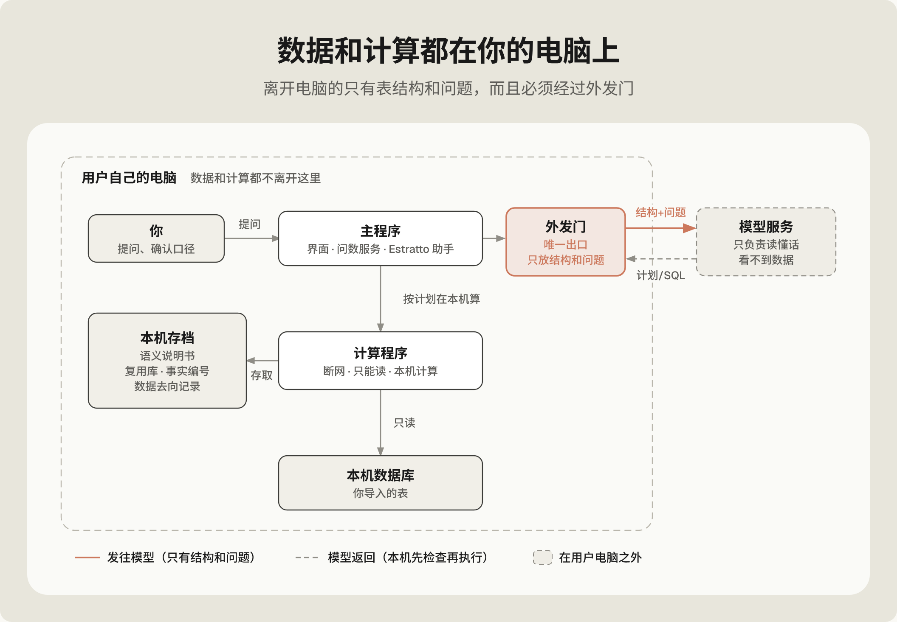
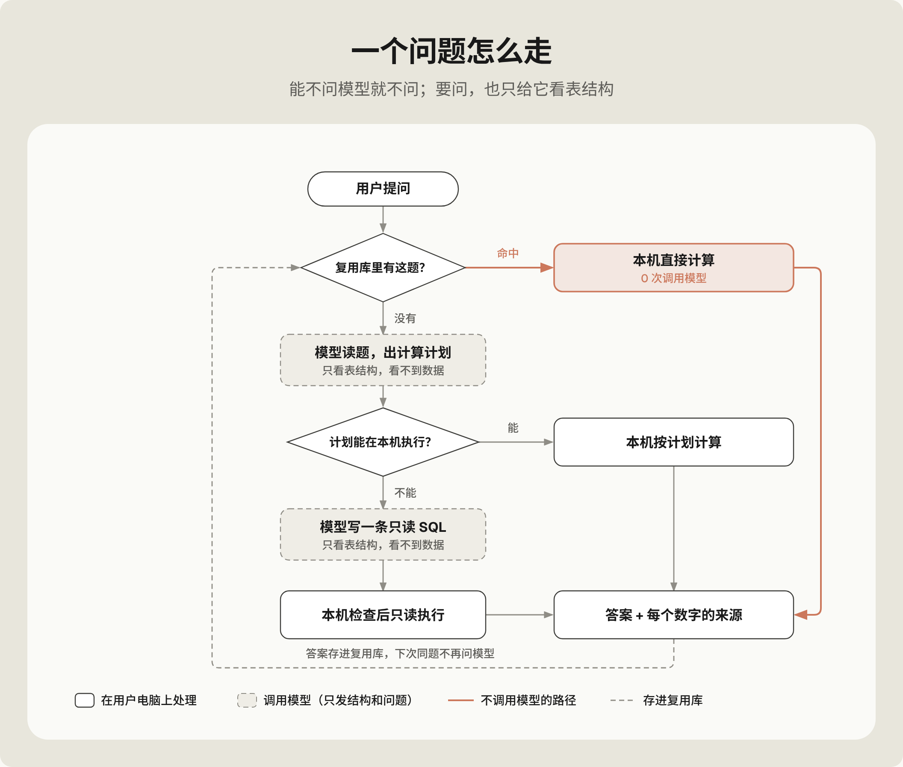
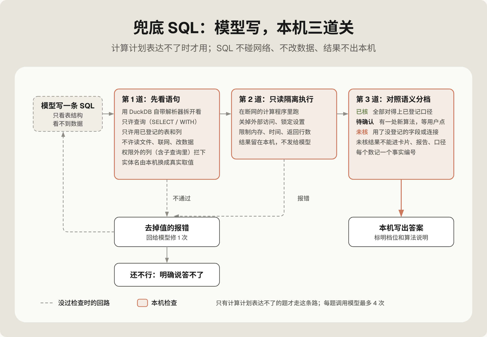
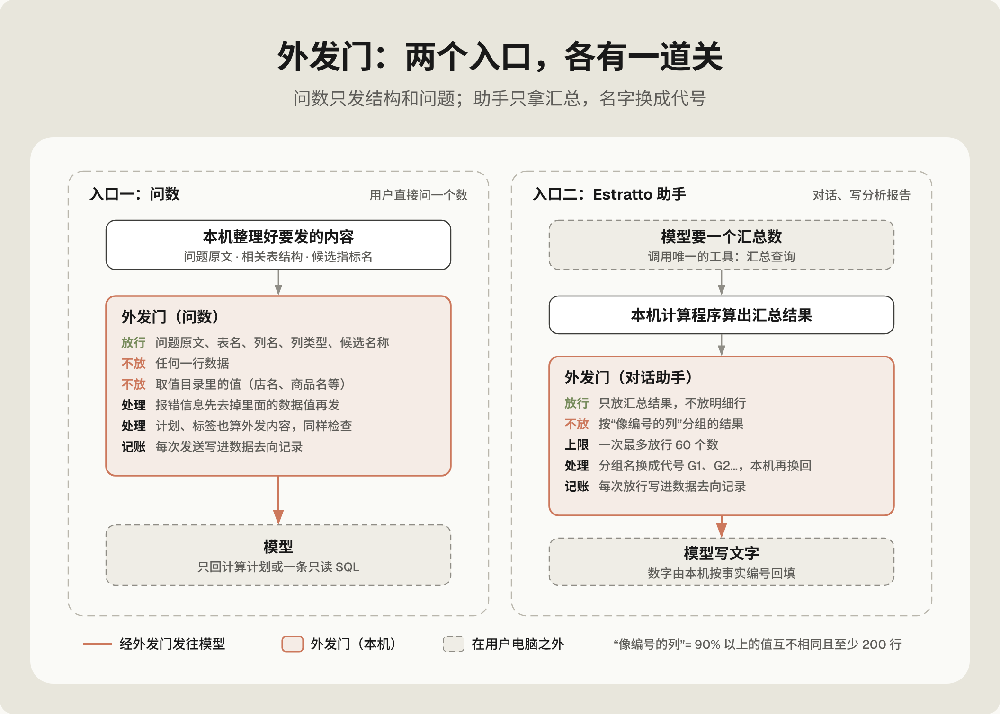
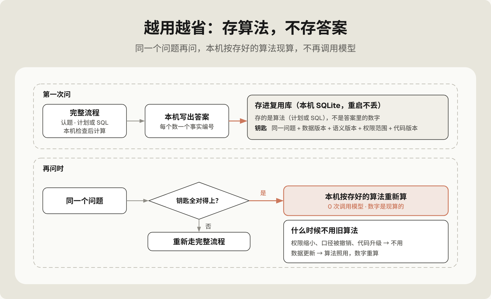
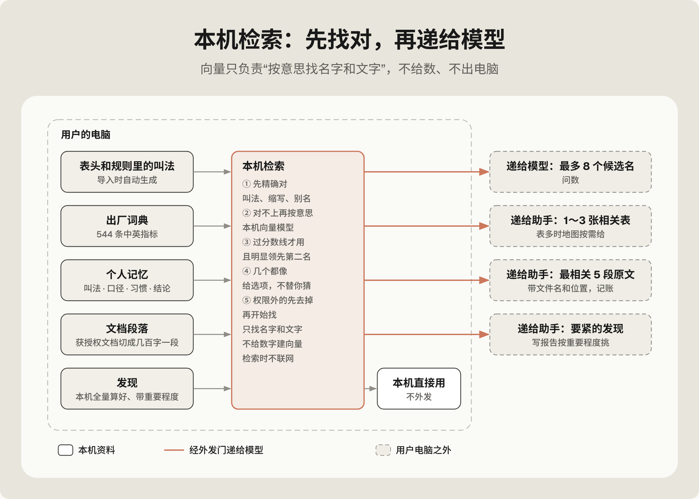
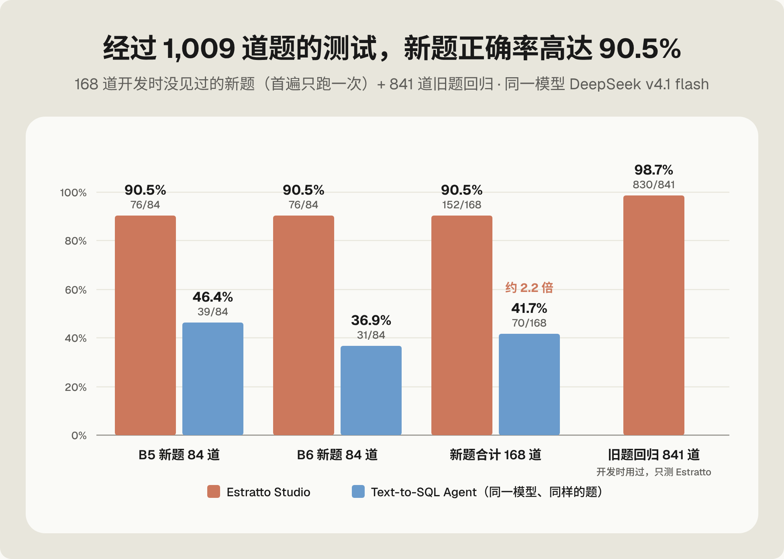
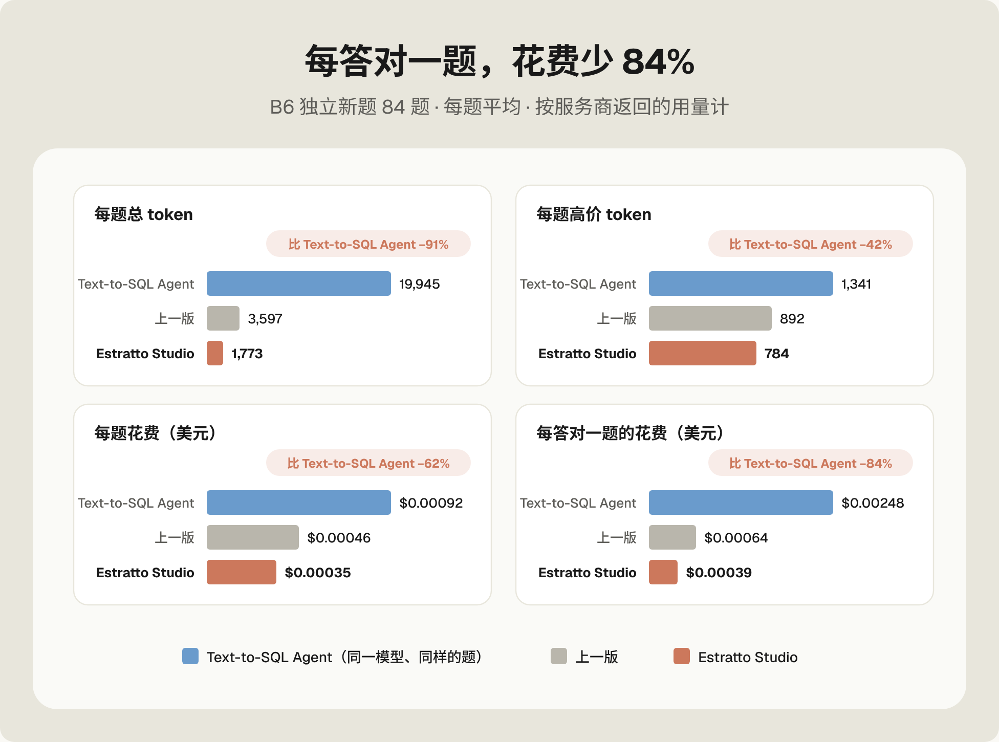

<a href="mechanism-report.md">English</a> · <b>简体中文</b>

# Estratto Studio · 机制技术报告

j7ckson

> **状态：还在持续更新。** 本报告描述当前的引擎，引擎和评测有变化时会同步更新。

## 摘要

Estratto Studio 是一个装在用户自己电脑上的**数据管理与分析软件**（初始版本基于经营分析场景所开发）。用户问问题>>它从用户导入的表里算出答案。

这份报告讲两件事：**引擎怎么工作**，以及**做得怎么样**。

核心思路：**模型负责读懂，本机负责计算。** 大语言模型只读问题和表结构，写出一份结构化的计算计划；本机检查计划，用 DuckDB 算出每一个数。模型看不到任何一行数据。

B6（84 道开发时没见过的新题，每个系统只跑一次，用同一个模型）上的成绩：

- **答对 90.5%**（76/84）。Text-to-SQL Agent 答对 36.9%（31/84），Estratto Studio 是它的 **2.45 倍**。
- **每题 1,773 token**，Text-to-SQL Agent 19,945（少 91%）；**平均每答对一题的花费少 84%**。
- **同一个问题问第二遍，84.5% 不再调用模型。**
- **发给模型的数据行：0。**

---

## 1. 名词解释

| 词               | 意思                                                                                                                       |
| --------------- | ------------------------------------------------------------------------------------------------------------------------ |
| Estratto Studio | 本产品，装在用户自己电脑上的**数据管理与分析软件**（初始版本基于经营分析场景所开发）                                                                             |
| 本机              | 装有Estratto Studio的本机电脑。数据存在本机，数字也在本机算，0服务器需要。                                                                            |
| 模型              | 远端的大语言模型服务，只负责读懂话，不负责算数。本轮是 DeepSeek v4.1 flash，经 OpenCode Go 接入                                                         |
| Text-to-SQL Agent | 对照组：一个多步的 Agent，自己写 SQL。同一个模型，拿到和 Estratto Studio 一样的表结构、指标算法和表关系说明；它自己写只读 SQL，每次最多看 60 行结果，最多调用模型 4 次，最后一次必须给答案 |
| 新题（B5、B6）       | 两套各 84 题的新题（中文 60、英文 24）。由 Codex GPT-6.1-Sol (中) 出题，开跑前锁定，开发时从没见过                                                        |
| 只跑一次            | 每个系统每道题只答一次，不重跑挑好成绩                                                                                                      |
| 语义              | 本机存的一份“说明书”：每张表、每一列是什么，指标怎么算，表和表怎么连                                                                                      |
| 计算计划            | 一份结构化的“算什么”清单：指标、分组、时间、筛选、排名、比较。不含任何数字                                                                                   |
| 兜底 SQL          | 计划表达不了时，让模型写的一条只读查询；在本机检查过才执行                                                                                            |
| 外发门             | 本机唯一的出口：决定什么能发给模型，并记下每一次外发                                                                                               |
| 事实编号            | 本机算出的每个数都有一个编号（F1、F2…），记着它是怎么算出来的                                                                                        |
| 口径              | 一个指标的算法定义，例如“销售额含不含退款”                                                                                                   |
| token           | 模型按“字块”计费的单位                                                                                                             |
| 高价 token        | 没吃到缓存的输入 + 输出。吃到缓存的输入约按 1/50 的价格计                                                                                        |
| 零调用             | 这次回答没有调用模型，由本机复用库直接算出                                                                                                    |

## 2. 背景：问数难在哪

问数要同时做到**数字对、花得少、数据不外流**。

- **话有歧义。** “上个月的销售额”可以含退款，也可以不含；库存是某一天的数，把每天的加起来就错了。一旦理解错，数字就错一大截。
- **模型算不准。** 大语言模型擅长理解文字，不擅长精确计算，而且算错了看起来也很像真的。
- **数据敏感。** 把订单和客户数据发给远端模型，就是交给了别人。
- **模型按字收钱。** 多一次来回、多发一行数据，都会导致成本上升。

常见做法各自只顾得上一部分：

| 做法                | 怎么做              | 好处         | 代价                                |
| ----------------- | ---------------- | ---------- | --------------------------------- |
| text-to-SQL Agent | 模型自己写 SQL、看结果、再改 | 灵活，不用准备    | 准不准看临场发挥；本轮每题约 2 万 token；数据行要发给模型 |
| 语义层产品             | 人先把指标建好，模型从里面选   | 语义层覆盖的部分很准 | 前期要人工建模；语义层没覆盖的问题答不了              |
| 强模型通用 Agent       | 用最强的模型自己探索数据     | 通常很准       | 贵很多倍；数据要交给模型                      |

**Estratto Studio 的做法**：把“读懂话”和“算数”拆开。模型只看问题和表结构；数字全部在本机算。语义在导入数据时自动生成，不用人先建模；算过的方法存起来，下次直接用。

## 3. 整体架构

图 1：虚线框里的部件都在用户的电脑上。只有经过外发门的表结构和问题会发给模型；模型返回的内容要先在本机检查，才会执行。

| 部件    | 在哪 | 做什么                                    | 不做什么                       |
| ----- | -- | -------------------------------------- | -------------------------- |
| 主程序   | 本机 | 界面；数据分析和 Estratto 助手；把问题交给模型、把计划交给计算程序 | 不替模型解读数据                   |
| 计算程序  | 本机 | 用内置的分析数据库 DuckDB 算数                    | 连不上网；写不了工作区以外的地方（操作系统沙盒强制） |
| 本机数据库 | 本机 | 存导入的表                                  | 不上传                        |
| 本机存档  | 本机 | 语义说明书、复用库、事实编号、数据去向记录                  | 不存密钥                       |
| 外发门   | 本机 | 检查并记录每一份发给模型的内容                        | 不放行数据行                     |
| 模型服务  | 线上 | 读懂问题，返回计算计划或一条只读 SQL                   | 看不到数据，不计算                  |

**两个入口，一套引擎。** 用户可以直接问数，也可以和 Estratto 助手对话、让它写分析。两个入口用的是同一个问数服务、同一份语义和同一套外发规则，所以同一个问题从哪个入口问，得到的都是同一个数。

## 4. 整套机制

### 4.1 导入与自动语义

部分公司可能没有统一 ERP，数据可能是从独立站、广告后台、电商平台等不同来源导出的表，列名是 Ad Spend、Clicks 这样的英文，用户却用中文问。软件要先知道每一列是什么、表和表怎么连。

导入时自动完成，不用人先建模：

1. **先查出厂词典**：内置约 544 条中英对照和常用指标，覆盖广告、电商、财务、库存、物流。例如 ROAS = 广告收入 ÷ 广告花费。这一步不调用模型。
2. **词典认不出的列，问模型一次**：只发表名、列名和类型，不发任何数据值。模型给出中文名和常见叫法，并指出“名字不同但指同一个东西”的列。
3. **表之间的关系用数据实测**：一边的值在另一边全部找得到，才算能连。
4. **中文名只用来听懂和回答**：计算时一律用原始列名，翻译错了也不会算错列。
5. **自动起的口径可以直接用**，答案里标“待确认”。

导入时顺手处理常见的坑：美式日期、时区、货币符号、“--”代表空值、百分比、表尾的 Total 合计行、Windows 中文编码、编号列保留成文字（不丢前导 0）。币种不确定时，不默认写成“元”。

### 4.2 一个问题怎么走

图 2：橙色线是不调用模型的路径；虚线框是调用模型的步骤，每一步模型都只看表结构。

| 顺序        | 做什么                             | 问模型吗            |
| --------- | ------------------------------- | --------------- |
| 1 查复用库    | 同一个问题、同样的数据、口径和权限，以前算过就按存好的算法重算 | 不问              |
| 2 本机先认题   | 找出可能的指标、对象、时间（4.3）              | 不问              |
| 3 模型出计划   | 填一张结构化的计算清单（4.4）                | 1 次（不完整可再修 1 次） |
| 4 本机核对并计算 | 问题里的每个条件都进了计划，然后用 DuckDB 算      | 不问              |
| 5 兜底 SQL  | 计划表达不了才走（4.5）                   | 1 次（出错可再修 1 次）  |
| 6 出答案     | 本机生成答案，带事实编号和口径；算法存进复用库         | 不问              |

每题最多调用模型 4 次，超过就明确说答不了。

### 4.3 本机先认题

模型拿到的不是一整本说明书，而是一道选择题。

| 机制     | 做什么                                                                                                         |
| ------ | ----------------------------------------------------------------------------------------------------------- |
| 候选检索   | 按固定顺序找：用户自己的叫法 → 表头和规则里的叫法 → 出厂词典 → 本机向量模型。去重后取前 8 个                                                        |
| 本机向量模型 | 默认 bge-small-zh-v1.5（随安装包），中英混合时可换 multilingual-e5-small，都在用户电脑上运行，按“意思接近”找。例如“英国”能对上 United Kingdom。见 4.14 |
| 权限先过滤  | 不在这次问数权限范围里的表和列，在找候选之前就去掉，模型连名字都看不到（当前桌面版默认范围是整个工作区；调用方可以收窄，比如只让某次问数用其中几张表或几列）                              |
| 实体查找   | 问题里点名的店铺、类目、商品，到本机的取值目录里查。结果只有四种：唯一一个 / 好几个（问用户）/ 确实没有 / 目录不完整（不确定）。“没查到”不等于“不存在”                           |
| 取值匹配   | 用户的叫法和数据里的写法对不上时，在本机找最像的几个，**只拿给用户选，不发给模型**；选过一次就记住                                                         |
| 时间解析   | 把“今年 6 月”“上个完整月”“最近 3 个月”“同比”换成确切日期，用标准日历库算；不存在的日期直接拒绝                                                      |

### 4.4 计划车道：模型出计划，本机来算

这是主路，大多数题问模型 1 次就结束。

模型只填固定的格子：**指标**（只能从候选里选）、**分组**、**时间**、**筛选**、**排名 / 名次**、**比较**（差值或倍数）、**显示**（小数位、百分比）。它不写任何数字。

本机先核对，不对就不执行：

1. 每个格子都要是允许的写法：指标必须在候选里，列必须是用户有权看的。
2. 问题里提到的每个对象、时间和条件，都要在计划里找得到；漏了就告诉模型漏了什么，让它补一次。
3. 模型说表达不了，就不再让它改计划，直接转去兜底 SQL(Write-SQL)，省掉一次无用的修复。

容易算错的地方，算法写在本机，不靠模型记得：

- **比率**：分子、分母分别求和再相除，不把每行的比率加起来。
- **库存这类时点数**：取期末那一天，不把每天的加起来。
- **“最久”“最长”“最老”**：认成取最大值。
- **排名的并列和空值**：按固定规则处理，并在结果里写明。

能表达的计算方式：除了求和、计数、平均、同比环比，第三轮起又加了 10 种，都用 DuckDB 自带的函数实现：

- 按星期几 / 月内第几天分组
- 指定名次
- 前 N 名合计占比
- 成员之间的倍数
- 日均与窗口对比
- 实际 ÷ 计划（跨表对齐）
- 字段的最大最小值
- 逐行条件计数
- 按日均能撑多少天
- 数据体检

### 4.5 兜底 SQL：本机三道关

图 3：模型写的 SQL 要连续过三道本机的关；虚线是唯一一次重试。

有些题装不进固定格式，例如“库龄最长的 3 个商品里，哪个毛利最高”。这时让模型写一条只读 SQL；模型只看得到表名、列名、类型和登记过的表关系。

| 关            | 做什么                                                                                                              | 为什么                                        |
| ------------ | ---------------------------------------------------------------------------------------------------------------- | ------------------------------------------ |
| 第 1 道：先看语句   | 用 DuckDB 自带的解析器拆开看。只许 SELECT / WITH；只许用登记过的表和列；不许读文件、联网、改数据。权限外的列不管藏在子查询（CTE）里、还是没写表名前缀，都拦下。问题里的对象名由本机换成数据里的真实写法 | 拆开看，不靠“搜关键字”这种容易绕开的办法；取值目录不发给模型            |
| 第 2 道：只读隔离执行 | 在断网的计算程序里跑；打开 DuckDB 的安全开关：关掉外部访问、锁定设置，限制内存、时间和返回行数。结果留在本机                                                       | 就算第 1 道漏了什么，也只能读、不能写、不能联网：操作系统沙盒 + 数据库开关两层 |
| 第 3 道：对照语义分档 | 把每处聚合、连接、筛选、分组和语义逐项对照，分成“已核 / 待确认 / 未核”（4.6）                                                                     | 让用户知道这个数能信到什么程度                            |

没过第 1 道、或在第 2 道报错时，把去掉了数据值的报错发回给模型修**一次**；还不行，就明确说答不了。

“语义优先、表达不了再写 SQL”的顺序，和 dbt 官方建议的做法一致。

### 4.6 三档可信度、事实编号与答案

| 档       | 什么情况                     | 能进卡片 / 报告 / 口径吗 |
| ------- | ------------------------ | --------------- |
| **已核**  | 每一处都对得上已登记的指标、关系和维度      | 能               |
| **待确认** | 有一处新算法，例如“完成率 = 实际 ÷ 计划” | 用户确认后能，并存成用户的口径 |
| **未核**  | 用了没登记的字段或连接              | 不能              |

**什么算“登记”**：在「字段与规则」里有名字和口径的、用户说过的、用户确认过的、导入时实测过的表关系。只是表里有这一列、词典猜的叫法、模型自己推的算法，都不算。

**事实编号**：本机算出的每个数都记成一条“事实”，写着值、算法和数据版本。每次回答都记新的事实，所以重启后编号会变，但数不变。

**答案怎么生成**：

- 问数时，答案的文字和数字都在本机按事实生成，并写明口径。
- 助手里，模型写的文字里只有占位符（如 {F3}），数字由本机回填。真 App 测试里，模型的原始回答和发出去的内容里都没有那几个合计数。

### 4.7 不确定先问、缺字段拒答

| 情况                | 软件怎么做                         |
| ----------------- | ----------------------------- |
| 对象有好几个候选          | 先问用户；候选只在本机展示                 |
| 完整目录里确实没有这个对象     | 明确说没有                         |
| 目录不完整             | 说“不确定”，不说“没有”                 |
| 数据里没有需要的字段        | 明确拒答，并点名缺的是哪个概念，不拿别的字段顶替      |
| 日期不存在（如 2 月 31 日） | 直接拒绝                          |
| 币种不确定             | 不默认币种                         |
| 计划和 SQL 都做不出来     | 明确说答不了，并记下这句问法，用来决定下一种要补的计算方式 |

B6 里有 11 题故意问数据里没有的概念，正确答案就是拒答，给出任何数字都算错。

### 4.8 外发门

图 4：左边是问数入口，右边是 Estratto 助手入口；橙色框是本机的外发门。

**问数入口**

| 内容                            | 发不发           |
| ----------------------------- | ------------- |
| 问题原文、相关表结构、登记过的表关系、最多 8 个候选名称 | 发             |
| 任何一行数据                        | 不发            |
| 取值目录里的值（店名、商品名）               | 不发            |
| 报错信息                          | 去掉数据值后才发      |
| 修复时发回去的计划、标签                  | 和其他外发内容一样过门检查 |

**助手入口**：模型只有一个工具“汇总查询”，每次结果都要过门：

- 只放汇总，不放明细行
- 不按“像编号的列”分组（90% 以上的值互不相同、且至少 200 行）：按订单号分组的“汇总”其实就是明细
- 一次最多放行 60 个数
- 分组名换成代号 G1、G2…，本机再换回
- 文字里的数字由本机按事实编号回填

**记账（数据去向记录）**：每次外发按“预留 → 发送中 → 已发送 / 状态不明 / 已中止”记录。断网时说不清发没发出去的，记“状态不明”，不当作没发。

对 B6 的 596 条模型请求做了独立审计：Estratto Studio 请求里的对象名只来自题面；修复时发出的报错只含类型和权限信息。

### 4.9 权限：一套范围管到底

1. **权限范围由本机可信服务生成**：界面、模型、外部请求都不能自己声明“我能看什么”。
2. **只能收窄，不能放宽。**
3. **禁止列只累加**：多次收窄，第一次禁止的列不会被“放出来”。
4. **先过滤，再找候选**：无权的表和列在找候选之前就去掉，模型连名字都看不到。
5. **执行前再查一遍**：计算计划和 SQL 都要对照范围，包括子查询里的列、没写表名前缀的列。

复用库的钥匙里包含权限范围，权限一收窄，旧算法就不再直接用。

5 种绕过方法的端到端测试，全部挡住。

### 4.10 程序隔离与自检

“能读数据”和“能联网”拆在不同的程序里，由操作系统强制隔开：

| 程序   | 能做                | 不能做                  |
| ---- | ----------------- | -------------------- |
| 主程序  | 界面、服务、本机存档（唯一写入者） | 不直接联网，只能交给外发门        |
| 计算程序 | 读工作区、算数           | **连不上网**；写不了工作区以外的地方 |
| 联网程序 | 把外发门放行的内容发出去      | **读不到工作区**           |

启动时先自检两个方向：不该通的确实不通，该通的确实能通（只查前一条，会掩盖“其实全断了”的情况）。自检不通过，问数和对话保持锁定，并告诉用户哪一项没过。

### 4.11 越用越省：复用

图 5：上半部分是第一次问，下半部分是同一个问题再问。

- **存什么**：存算法（核对过的计算计划，或过了三道关的 SQL），不存数字。复用时在当前数据上重新算。
- **存在哪**：本机 SQLite，重启不丢。
- **钥匙**：同一个问题 + 数据版本 + 语义版本 + 权限范围 + 代码版本。

| 变了什么       | 结果            |
| ---------- | ------------- |
| 权限范围       | 不用旧算法         |
| 口径（被改或被撤销） | 不用旧算法         |
| 代码版本       | 不用旧算法         |
| 数据         | 算法照用，仅需重算最新数字 |

### 4.12 口径确认与版本

同一个词在不同公司意思不同，有些口径只能由用户说了算。

1. 自动生成的口径可以直接用，标“待确认”。
2. 用户确认后变成“已登记”，语义版本加一。
3. 用户撤销，语义版本再变，依赖它的旧结果不再拿出来。
4. 再次确认，恢复。

这一整圈（确认 → 重启后 0 次调用命中 → 撤销后不给旧数 → 再确认恢复）在真实 macOS App 上测试通过。

### 4.13 可控：调用、输出、取消、记账

| 机制     | 具体                                     |
| ------ | -------------------------------------- |
| 调用上限   | 每题最多 4 次（计划 2 次 + SQL 2 次），正常题碰不到      |
| 输出上限   | 问数每次最多 320 token（评测用 400）；助手每轮最多 4,000 |
| 关闭深度思考 | 问数关闭模型的思考模式；评测核对过思考 token 为 0          |
| 取消     | 按请求编号真正中止正在进行的问数，迟到的结果直接丢掉             |
| 外发记账   | 每次外发都有记录（4.8）                          |

### 4.14 本机检索（RAG）与向量

**RAG 在这里是什么意思**：先在本机把和这句话相关的东西找出来、挑好，再递给模型。找的只是名字和文字；数字从来不靠检索，一律由本机算。

图 8：五种本机资料先精确对、再按意思找，过分数线才用；递给模型的只有挑好的那一小部分，个人的叫法、口径和习惯在本机直接用。

**用在五个地方**

| 用在哪    | 找什么     | 怎么找                                                                                                        | 递给谁       |
| ------ | ------- | ---------------------------------------------------------------------------------------------------------- | --------- |
| 问数认题   | 指标、维度候选 | 记忆 → 表头和规则叫法 → 出厂词典 → 向量，去重后取前 8 个（4.3）                                                                    | 模型        |
| 地图按需给  | 相关的表    | 整份数据地图超过 7,000 字时，开头只给表名清单；每句话本机先猜出 1～3 张可能用到的表附上；助手要别的表再取，一次最多 8 张                                        | 助手        |
| 记忆召回   | 以前的结论   | 关键词命中 + 向量的意思像，最多看 5,000 条；同一问题 + 同样的取数只留最新一条。结论只当线索，数字一律重算                                                | 助手（不含旧数字） |
| 文档检索   | 文档里的段落  | 获授权的文档切成几百字一段；按「字词命中（中文两个字一组，常见词分量轻）+ 向量按短句比」挑最相关的 5 段，带文件名和正文位置；每段都记进文档外发记录                               | 助手        |
| 写报告挑素材 | 发现      | 本机全量算好每节的发现：涨跌最多的组和占整体变化多少、新出现 / 消失的组、利润率掉得多的、在亏钱的（不管排第几）、哪几天没数据……每条带重要程度。每节「要点」最多占一半名额，摘要和建议拿全份报告最要紧的 8 条 | 助手        |

**本机向量模型**

| 模型                              | 大小     | 怎么来                                              | 用途                               |
| ------------------------------- | ------ | ------------------------------------------------ | -------------------------------- |
| bge-small-zh-v1.5（int8 量化）      | 24 MB  | 随安装包                                             | 默认，中文为主                          |
| multilingual-e5-small（int8 量化）  | 118 MB | 第一次用到才下载：两个下载源轮流、断点续传、大小和 sha256 校验；下载失败就继续用 bge | 中文问、英文数据（如「英国」对上 United Kingdom） |
| bge-reranker-base（int8 量化，可选精排） | 279 MB | 默认关闭，用户打开才下载                                     | 把候选按「像不像」重新排                     |

- 模型用 onnxruntime-web（wasm）在计算程序的单独线程里跑，不装原生模块，推理全在本机。下载模型只是取文件，不发任何问题或数据。
- **只给名字和文字建向量，不给数字建。** 同一段文字只算一次，存在本机的向量缓存表里，只留最近 5 万条，不会越堆越多。

**向量只指路，不给数**

- 只会认到数据里已经有的名字，名单由数据决定，不会凭空造一个指标。
- 精确对不上才按意思找；够像（默认像度 0.8 以上）并且明显领先第二名才直接用；几个都像，就给选项，不替你猜。
- **考题过线才开**：出厂考题 95 道（五张常见的表，含不该认的题），加上你自己问过的问题（满 5 条才加考）。加了向量要认对得更多、认错的不能变多、认错率不超过 5%，才会打开。开发时实测：只用精确对 90/95、认错 0；加上向量 93/95、认错 0。
- 两个向量模型各考一遍：e5 在中英混合题上更好、中文题上不差过 3 个百分点，才选 e5，否则用 bge。换模型、词典或考题都会重考；也可以整块关掉。

### 4.15 本机的库：数据存在哪、怎么存

所有东西都存在用户自己的电脑上，分两个库，各管一摊。

**分析库（DuckDB）：存数据、算数**

| 存什么     | 怎么存                                         |
| ------- | ------------------------------------------- |
| 原始快照    | 每次导入原样留一份（全部按文字存），永久保留，随时能追溯                |
| 当前版本表   | 导入或重建时，一次把类型转好、按日期排好，存成表；查数直接读它，不再每次现场转换和去重 |
| 合表的临时结果 | 同一份数据（表 + 版本 + 关联）只转换一次                     |

- 导入走单独的线程和单独的数据库连接，看板、透视、助手的查询不用排队等导入。
- 实测（同一批数据，改前 → 改后）：10 个文件 50 万行导入 109 秒 → 12 秒；导入期间点看板卡片，中位等待 1.3 秒 → 0.01 秒；导完查数 3 秒 → 0.01 秒。

**状态库（SQLite）：存「记得的东西」**

| 存什么         | 说明                                            |
| ----------- | --------------------------------------------- |
| 导入记录、表和版本   | 每张表的每一版都记着，复用和作废靠它判断                          |
| 看板卡片        | 只存「取数单」，每次按最新数据重算，不存旧数字                       |
| 数据去向记录      | 外发门的账本（4.8）                                   |
| 个人记忆        | 叫法 / 口径 / 习惯一行一条；以前的结论存「问题 + 口径 + 数据版本」，不存旧数字 |
| 事实编号 F、代号 G | 一行一条，只追加新的                                    |
| 报告和版本       | 一份一行、一版一行；改一个字只写那一份                           |
| 向量缓存        | 见 4.14                                        |
| 复用库         | 计划和结果，带全部版本钥匙（4.11）                           |
| 对话          | 对话和消息                                         |

**内存里的一层**：同样的只读计算，在数据没变时只算一次（报告重算、对话里又问一遍、看板刷新都直接用）；一有导入或重建，旧结果全部作废。实测重算一份报告，8 次计算全部复用，33 毫秒。

## 5. 和其他做法比

“Text-to-SQL Agent”一列是本轮实测；另外两列是这类做法的一般情况，各家产品具体不同，本轮没有和它们做同题对比。

|              | Text-to-SQL Agent（实测）   | 语义层产品         | 强模型通用 Agent | **Estratto Studio** |
| ------------ | -------------- | ------------- | ----------- | ------------------- |
| 谁读懂问题        | 模型             | 模型，从人建好的语义层里选 | 模型          | 模型，从本机挑好的候选里选       |
| 谁算数          | 模型写 SQL，看结果再改  | 语义层生成的查询      | 模型写查询或代码    | 本机按登记的公式算           |
| 要不要人先建模      | 不要             | 要             | 不要          | 不要，导入时自动生成，可改       |
| 语义层装不下的题     | 照样写 SQL        | 要人补语义层        | 照样写         | 走兜底 SQL，三道关         |
| 模型看不看得到数据行   | 看得到（每次 ≤ 60 行） | 取决于产品         | 一般看得到       | **问数看不到；助手只看打码的汇总** |
| 操作系统级隔离      | 无              | 取决于产品         | 取决于设置       | **有**               |
| 同一个问题再问      | 从头再查           | 取决于产品         | 一般从头再查      | **本机重算，0 次调用**      |
| 每题 token（B6） | 19,945         | —             | —           | **1,773**           |
| B6 准确度（同一模型） | 36.9%          | —             | —           | **90.5%**           |

## 6. 评测方法

**三组对照**

| 组               | 是什么                               |
| --------------- | --------------------------------- |
| Estratto Studio | 第六轮最终候选（B5 用 P79d 版本，B6 用 P80 版本） |
| 上一版             | 第六轮改进之前的引擎                        |
| Text-to-SQL Agent        | 见第 1 节                            |

三组都用 DeepSeek v4.1 flash（经 OpenCode Go），温度 0，关闭深度思考，每次最多输出 400 token。

**题库**

| 题库          | 题数                    | 用来证明  |
| ----------- | --------------------- | ----- |
| B6 新题       | 84（中文 60 + 英文 3 套各 8） | 主成绩   |
| B5 新题       | 84（同上结构）              | 另一套新题 |
| 公开旧题        | 中文 200 + 英文 67        | 没退步   |
| 内部旧题        | 500 + 60              | 没退步   |
| dbt 公开示例题   | 11                    | 公开参照  |
| Neo4j 公开示例题 | 3                     | 公开参照  |

**新题怎么出**：

- 由 Codex GPT-6.1-Sol (中) 出题。
- 每题的标准答案用两种独立算法各算一次，两次一致才收。
- B6 里 73 题是数值题，11 题是“应该拒答”的题。
- 和所有旧题去重，开跑前锁定，开发这边看不到。

**怎么跑**：

- 每套题每个系统只跑一遍，不重跑。
- B6 按真实 App 的用法一题一题顺序跑。
- 首遍跑完后，把 84 题倒序再问一遍，测复用。
- 另加 48 道变式探针：换说法、换参数、数据更新、重启。

**怎么判**：

- 一个锁定的判分程序，三组用同一把尺子，过程中不改题、不改标准答案、不改判分。
- 16 组结果和 16 组探针全部独立重判，零差异。
- 分数和 token 都从服务商原始记录复算。

**花费怎么记**：

- 总 token = 一题里所有模型调用的输入 + 输出。
- 高价 token = 没吃到缓存的输入 + 输出。
- 美元按服务商返回的用量和 OpenCode Go 公布的单价估算，不是账单。
- 2,218 个真实请求逐条和账本对上。

## 7. 成绩

### 7.1 准确度

本轮一共测试了 **1,009 道题**，都用同一个模型：168 道开发时没见过的新题（B5、B6 各 84 道，首遍只跑一次）答对 152 道（90.5%），Text-to-SQL Agent 答对 70 道，约 2.2 倍；841 道旧题回归答对 830 道（98.7%），明细见下方「旧题不退步」。旧题开发时用过，所以两类分开算，不合成一个准确率。

图 6：本轮全部 1,009 道题，新题首遍只跑一次，同一个模型（DeepSeek v4.1 flash）。

| 数据集             | 题数     | 上一版           | **Estratto Studio** | Text-to-SQL Agent |
| --------------- | ------ | ------------- | ------------------- | ----------------- |
| 中文电商            | 60     | 43            | **54**              | 21                |
| 华盛顿州 Amazon 采购  | 8      | 6             | **8**               | 3                 |
| 洛杉矶开放数据网站流量     | 8      | 6             | **7**               | 2                 |
| LAcity.org 网站流量 | 8      | 5             | **7**               | 5                 |
| **合计**          | **84** | **60（71.4%）** | **76（90.5%）**       | **31（36.9%）**     |

- B6 上，上一版答错、这一版答对的有 18 题。
- B5 上：Estratto Studio 76/84（中文 53/60、英文 23/24），上一版 62，Text-to-SQL Agent 39。
- 在 Text-to-SQL Agent 也限 4 次调用的条件下，B6 上 Estratto Studio 的答对题数是它的 2.45 倍。

**旧题不退步**

| 题库          | 成绩        | 原来答对的题  |
| ----------- | --------- | ------- |
| 公开中文        | 198 / 200 | 147 题全保 |
| 公开英文        | 67 / 67   | 44 题全保  |
| 内部 500      | 494 / 500 | 485 题全保 |
| 内部 60       | 57 / 60   | 55 题全保  |
| dbt 公开示例题   | 11 / 11   | —       |
| Neo4j 公开示例题 | 3 / 3     | —       |

### 7.2 花费

图 7：B6 每题平均；右上角是比 Text-to-SQL Agent 少的比例。

| 每题       | Text-to-SQL Agent | 上一版      | **Estratto Studio** | 比 Text-to-SQL Agent | 比上一版 |
| -------- | -------- | -------- | ------------------- | --------- | ---- |
| 总 token  | 19,945   | 3,597    | **1,773**           | −91%      | −51% |
| 高价 token | 1,341    | 892      | **784**             | −42%      | −12% |
| 花费       | $0.00092 | $0.00046 | **$0.00035**        | −62%      | −23% |
| 每答对一题的花费 | $0.00248 | $0.00064 | **$0.00039**        | −84%      | −39% |

**为什么总 token 少得比花费多**：

- Text-to-SQL Agent 每一步都把整段对话再发一遍，所以总量大。
- 但重复发的开头大多吃到了服务商缓存（命中率 95%），约按 1/50 计价。
- Estratto Studio 每题只问 1～2 次，每次都很短。
- 所以按钱算，每题少 62%，每答对一题少 84%。

因为不发数据行，表再大，Estratto Studio 的花费也不会跟着涨。

### 7.3 越用越省

|        | 题数     | 不调用模型         | 其中答错 | 首遍对、复用变错 |
| ------ | ------ | ------------- | ---- | -------- |
| 中文     | 60     | 50            | 5    | **0**    |
| 英文     | 24     | 21            | 0    | **0**    |
| **合计** | **84** | **71（84.5%）** | 5    | **0**    |

- 加上之前的旧题，复用的 **266 题里 260 题正确（97.74%）**。
- 复用里出错的题，第一次就是错的；复用从没把对的变成错的。
- **重启后再问**：12 道重启探针题全部从本机复用库直接算出，0 次调用。
- **数据更新后再问**：12 道数据更新探针题全部在新数据上重算，0 次调用。

### 7.4 安全与真 App

| 项目                 | 结果                                                             |
| ------------------ | -------------------------------------------------------------- |
| 权限绕过（5 种方法，端到端）    | 全部挡住                                                           |
| 外发审计（B6 的 596 条请求） | 对象名只来自题面；修复时发出的报错里没有数据值                                        |
| 取值目录               | 不发给模型；经独立复现并复验                                                 |
| 助手里的数字             | 模型的输出和外发内容里都没有；由本机回填                                           |
| 真实 macOS App       | 冷导入 1,573 行；持久化、只读重启、迁移；问数 3 次调用，重启后 0 次；取消；口径确认与撤销一整圈；完整的助手对话 |
| 回归测试               | 65 个测试文件无新增失败；44 个合同测试通过，原验收 10/10，新增合同 7/7                    |

## 8. 公开示例题

dbt 公开的 11 道示例题和 Neo4j 公开的 3 道示例题上，Estratto Studio 答对 **11/11** 和 **3/3**，用的是导入时自动生成的语义，不是人工建好的语义层。这些题是公开的，所以只作为参照成绩列出，不算新题成绩。

## 9. 接下来

这份报告记录的是进行中的工作，接下来：

- 放出软件源码，发布第一个公开版本。
- 公开评测题（B6 和英文题）和判分程序。
- 让复用覆盖“换个说法”和“换个参数”（换个月份、换个店铺或商品）。
- 更好地利用服务商缓存，进一步降低高价 token。
- 在界面上加取消按钮、口径确认 / 撤销入口。
- 和最强的通用型 Agent 做同题对比。
- 为下一轮准备新题 B7。

## 附录

### A. 第六轮版本

| 版本   | 改了什么                              |
| ---- | --------------------------------- |
| P79c | 提示词不变的部分放前面；取值目录不再发给模型；若干理解修复     |
| P79d | 权限加固：禁止列累加                        |
| P80  | 助手输出上限 4,000；本机连接把上限传出去；独立的问数取消通道 |

### B. 计价（OpenCode Go 上的 DeepSeek v4.1 flash，每百万 token）

输入 $0.15 / $0.30 · 输出 $0.60 / $1.20 · 缓存输入 $0.003 / $0.006（服务商公布的两档单价）。

### C. 英文数据集

| 数据集                                               | 来源                              | 许可                   |
| ------------------------------------------------- | ------------------------------- | -------------------- |
| State Agency Amazon Spend FY18                    | 华盛顿州 DES，data.wa.gov（ja54-ddzj） | 官方没标许可；只提供下载脚本，不附原文件 |
| Open Data Website Traffic                         | 洛杉矶市，data.lacity.org（d4kt-8j3n） | CC0 1.0              |
| LAcity.org Website Traffic（2019-08-01 至 08-27 导出） | 洛杉矶市，data.lacity.org（822f-gjp4） | CC0 1.0              |
